# Experiment 1: Basic Image Processing Using OpenCV

## AIM

To perform basic image-processing operations on an input image using
Python and OpenCV, including drawing shapes and text, color-space
conversion, pixel modification, resizing, cropping, flipping, and saving
the processed image.

## Input Image

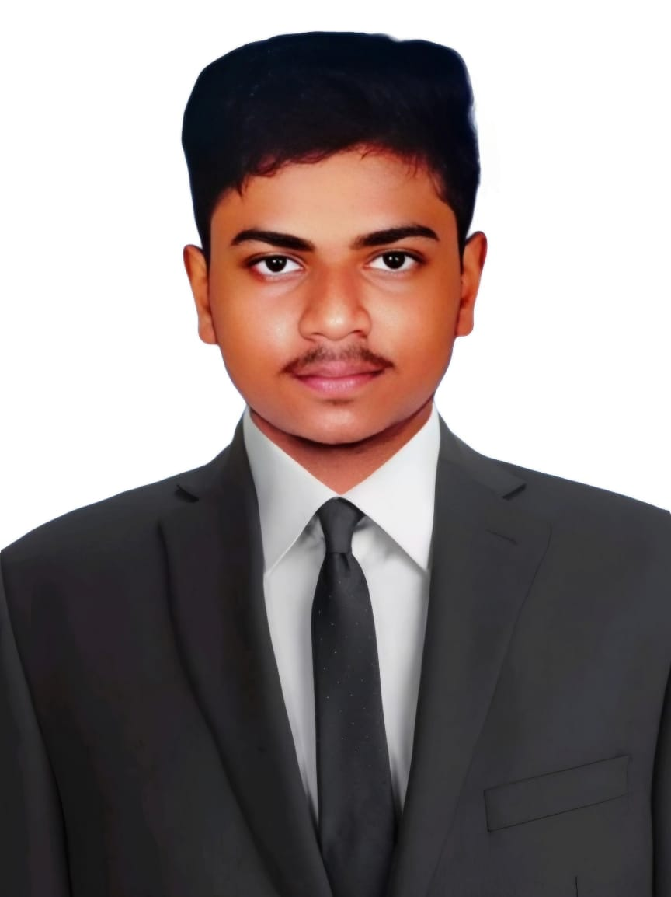


## PROCEDURE

1.  Import the required libraries: OpenCV (`cv2`) and Matplotlib
    (`matplotlib.pyplot`).
2.  Read the input image `Qno. 1.jpg` from the local directory using
    `cv2.imread()`.
3.  Convert the image from BGR to RGB format and display the original
    image.
4.  Draw a line from the top-left to the bottom-right of the image.
5.  Draw a circle at the center of the image, draw a rectangle around
    the image, and add the text **OpenCV Drawing**.
6.  Convert the RGB image into HSV, grayscale, and YCrCb color spaces
    and display each result.
7.  Convert the HSV image back into RGB format and display it.
8.  Access the pixel at coordinate `(100, 100)` and print its value.
    Modify the required pixel or region to white.
9.  Resize the original image to half its width and height.
10. Crop a region of interest (ROI) from the image and display it.
11. Flip the original image horizontally and vertically and display both
    results.
12. Save the final processed image using `cv2.imwrite()`.


## PROGRAM

### 1. Import Libraries and Display Original Image

```python
import cv2
import matplotlib.pyplot as plt

# Read the image
img = cv2.imread('my.jpeg', cv2.IMREAD_COLOR)

# Convert BGR to RGB
img_rgb = cv2.cvtColor(img, cv2.COLOR_BGR2RGB)

# Display original image
plt.imshow(img_rgb)
plt.title("Original Image")
plt.axis('off')
plt.show()
```

### 2. Drawing a Line

```python
image = cv2.imread('my.jpeg')
img_rgb = cv2.cvtColor(image, cv2.COLOR_BGR2RGB)

line_img = cv2.line(img_rgb, (0, 0), (900, 1200), (255, 0, 0), 10)

plt.imshow(line_img)
plt.title("Image with Line")
plt.axis('off')
plt.show()
```

### 3. Drawing a Circle

```python
image = cv2.imread('my.jpeg')
img_rgb = cv2.cvtColor(image, cv2.COLOR_BGR2RGB)

circle_img = cv2.circle(img_rgb, (450, 400), 250, (255, 0, 0), 10)

plt.imshow(circle_img)
plt.title("Image with Circle")
plt.axis('off')
plt.show()
```

### 4. Drawing a Rectangle

```python
image = cv2.imread('my.jpeg')
img_rgb = cv2.cvtColor(image, cv2.COLOR_BGR2RGB)

rectangle_img = cv2.rectangle(img_rgb, (100, 50), (750, 600), (0, 0, 255), 10)

plt.imshow(rectangle_img)
plt.title("Image with Rectangle")
plt.axis('off')
plt.show()
```

### 5. Adding Text to Image

```python
image = cv2.imread('my.jpeg')
img_rgb = cv2.cvtColor(image, cv2.COLOR_BGR2RGB)

text_img = cv2.putText(
    img_rgb,
    "OpenCV Drawing",
    (10, 30),
    cv2.FONT_HERSHEY_SIMPLEX,
    1,
    (0, 0, 0),
    10
)

plt.imshow(text_img)
plt.title("Image with Text")
plt.axis('off')
plt.show()
```

### 6. Color Space Conversion

```python
image = cv2.imread('my.jpeg')
image_rgb = cv2.cvtColor(image, cv2.COLOR_BGR2RGB)

# RGB Image
plt.imshow(image_rgb)
plt.title("Original RGB Image")
plt.axis("off")
plt.show()

# RGB to HSV
image_hsv = cv2.cvtColor(image_rgb, cv2.COLOR_RGB2HSV)

plt.imshow(image_hsv)
plt.title("HSV Image")
plt.axis("off")
plt.show()

# RGB to Grayscale
image_gray = cv2.cvtColor(image_rgb, cv2.COLOR_RGB2GRAY)

plt.imshow(image_gray, cmap='gray')
plt.title("Grayscale Image")
plt.axis("off")
plt.show()

# RGB to YCrCb
image_ycrcb = cv2.cvtColor(image_rgb, cv2.COLOR_RGB2YCrCb)

plt.imshow(image_ycrcb)
plt.title("YCrCb Image")
plt.axis("off")
plt.show()

# HSV to RGB
image_hsv_to_rgb = cv2.cvtColor(image_hsv, cv2.COLOR_HSV2RGB)

plt.imshow(image_hsv_to_rgb)
plt.title("HSV to RGB Image")
plt.axis("off")
plt.show()
```

### 7. Pixel Transformation

```python
image = cv2.imread('my.jpeg')

# Modify pixel region to white
image[200:600, 200:800] = [255, 255, 255]

image_rgb = cv2.cvtColor(image, cv2.COLOR_BGR2RGB)

plt.imshow(image_rgb)
plt.title("Modified Image")
plt.axis("off")
plt.show()
```

### 8. Resizing Image

```python
image = cv2.imread('my.jpeg')

print(image.shape)

# Resize image to half size
resized_image = cv2.resize(image, (768 // 2, 600 // 2))

resized_image_rgb = cv2.cvtColor(resized_image, cv2.COLOR_BGR2RGB)

print(resized_image_rgb.shape)

plt.imshow(resized_image_rgb)
plt.title("Resized Image")
plt.axis("off")
plt.show()
```

### 9. Cropping Image (ROI)

```python
image = cv2.imread('my.jpeg')

print(image.shape)

# Crop a region of interest
roi = image[50:350, 50:350]

roi_rgb = cv2.cvtColor(roi, cv2.COLOR_BGR2RGB)

plt.imshow(roi_rgb)
plt.title("Cropped Region of Interest")
plt.axis("off")
plt.show()
```

### 10. Horizontal Flip

```python
image = cv2.imread('my.jpeg')

flipped_horizontally = cv2.flip(image, 1)

flipped_horizontally_rgb = cv2.cvtColor(
    flipped_horizontally, cv2.COLOR_BGR2RGB
)

plt.imshow(flipped_horizontally_rgb)
plt.title("Flipped Horizontally")
plt.axis("off")
plt.show()
```

### 11. Vertical Flip

```python
flipped_vertically = cv2.flip(image, 0)

flipped_vertically_rgb = cv2.cvtColor(
    flipped_vertically, cv2.COLOR_BGR2RGB
)

plt.imshow(flipped_vertically_rgb)
plt.title("Flipped Vertically")
plt.axis("off")
plt.show()
```

### 12. Saving Processed Image

```python
cv2.imwrite("processed_image.jpg", image)

print("Image saved successfully")
```


## OUTPUT

The following outputs are obtained after executing the program:

1.  Original input image displayed.

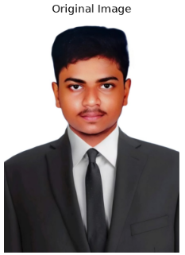

2.  Image with a diagonal line drawn from top-left to bottom-right.

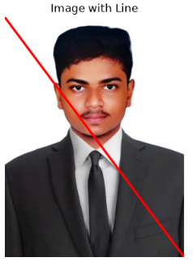

3.  Image with a circle at its center.

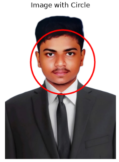

4.  Image with a rectangular border.

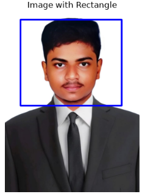

5.  Image displaying the text **OpenCV Drawing**.

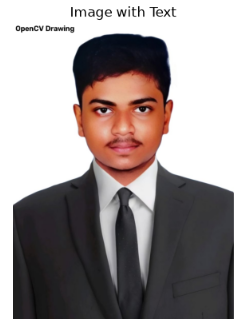

6.  HSV, grayscale, and YCrCb versions of the image.

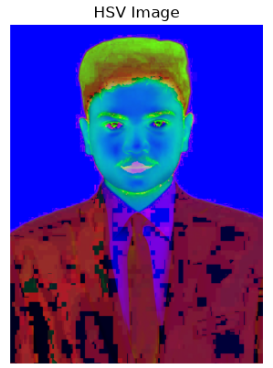

7.  Image converted from HSV back to RGB.

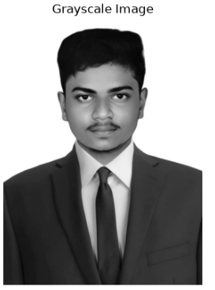

8.  Image with the selected pixel changed to white.

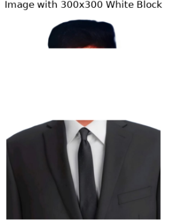

9.  Resized image with half the original width and height.

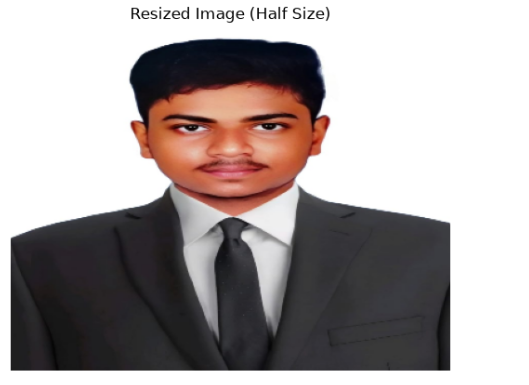

10. Cropped region of interest (ROI).

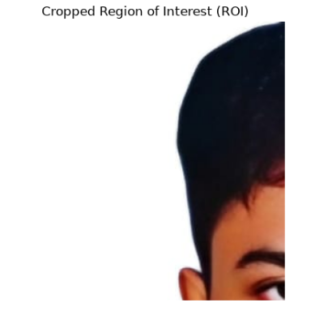

11. Horizontally flipped image.

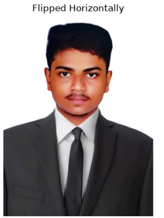

12. Vertically flipped image.

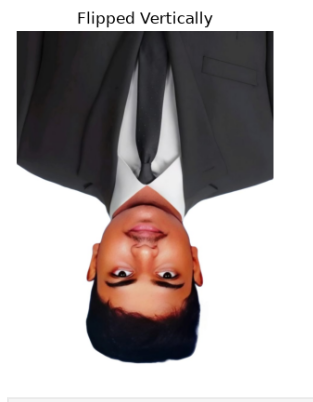


## RESULT

Thus, basic image-processing operations such as image loading,
displaying, drawing, color-space conversion, pixel modification,
resizing, cropping, flipping, and saving were performed successfully
using Python and OpenCV.
